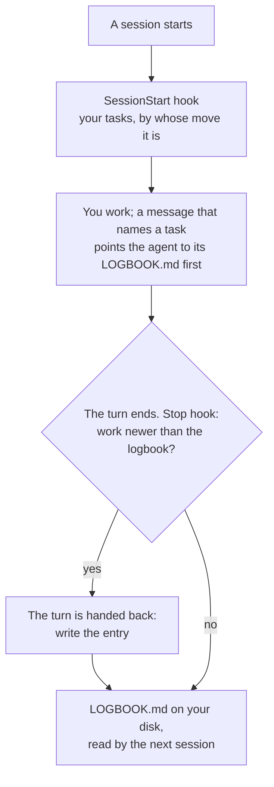

# Baton

**Your AI sessions end. Your work shouldn't.**

Baton makes an AI agent that runs in a host with hooks -- Claude Code, OpenAI Codex CLI, Google
Gemini CLI -- write its work down before a turn ends, and read it back when the next session starts.

Tired of explaining yesterday's work to Claude Code every morning? Of a `/clear` that wipes a
decision, or a session that ends without saying what is left?

Baton is a Claude Code plugin; the same hooks run under Codex CLI and Gemini CLI, set up by hand. Every task gets a folder with a `LOGBOOK.md`, and hooks that
Claude Code runs -- not the agent's judgement -- make sure the logbook is read when a session
starts and written before a turn ends. A rule in `CLAUDE.md` is advice the agent may skip; a hook
is not. Everything stays plain Markdown on your disk; installed as a plugin, the hooks make no network
request at all.

```bash
claude plugin marketplace add StanimirTenev/baton && claude plugin install baton@baton
```



Start a new session; once you have task folders, the agent's first reply opens with your tasks, ordered by whose move
it is (example data):

```text
⏳ Waiting on YOU / can continue now:
- 1 · migrate-billing 🔴 [high] — decide tax_region before the run

🔁 Ongoing:
- 2 · weekly-report 🟢 [low] — Monday export

⛔ Waiting on someone OUTSIDE / blocked (for information):
- 3 · broken-disk 🟡 [medium] — zpool replace  (waiting on: new disk (delivery))
```

**What it does not do**, measured on my own machine, 22–29 October 2026: the Stop hook handed
a turn back 43 times for a missing logbook entry; 29 got the entry, 14 ended without one. Baton
makes forgetting visible and hard; it does not make it impossible. Since v3.29.0 a turn that
answers the hand-back with no entry is handed back once more, and then let through.

## Where it works

| Where | Works? |
|---|---|
| Claude Code in the terminal | yes |
| Claude Code IDE extensions | yes |
| Code tab of the Claude desktop app | yes |
| claude.ai chat (web, desktop, mobile) | **no** -- hooks are ignored, only the skills load, nothing is enforced |
| Cowork | loads hooks, but Baton is untested there |
| OpenAI Codex CLI | yes, since v3.34.0 -- four of the six hooks, set up by hand: [codex/README.md](codex/README.md) |
| Google Gemini CLI | extension; live headless session proven 17.11 (v3.38.0), interactive not yet: [gemini/README.md](gemini/README.md) |

**A host, not a model.** Baton works in a *host*: an agent runtime that runs hooks when a session
starts and when a turn ends -- Claude Code, Codex CLI, Gemini CLI. The hooks read what the host
sends, not which model answers: on 17.11 the same hooks ran in Claude Code with Claude Opus 5.5,
in Codex CLI with a ChatGPT login, and in Gemini CLI with Gemini 3 Flash preview and 3.1 Pro
preview, and under each host the board reached the model; each model then read the logbook
itself. Whether a model follows the board and the hand-back is the model's; that it receives
them is the host's. **A chat in a browser runs no hooks**, so Baton enforces nothing there --
claude.ai, ChatGPT or Gemini on the web get no board, no hand-back and no logbook check.

**In a claude.ai chat nothing warns you:** the plugin looks installed and the skills load,
but no hook runs ([platform support](https://claude.com/docs/plugins/platform-support)).
A plugin added from the directory on claude.ai reaches Claude Code at its next session start.

## Install

Needs Python 3.8 or later; on Windows the plugin also needs Git for Windows. One of:

```bash
claude plugin marketplace add StanimirTenev/baton && claude plugin install baton@baton
git clone https://github.com/StanimirTenev/baton ~/.baton && ~/.baton/install.sh
```

Windows: `install.cmd`. Tasks go in `~/tasks` unless you choose another. With the script, keep
the clone: the tools, the doctor too, run from it. An agent installing Baton for you reads
[docs/install.md](docs/install.md) first. Then start a new Claude Code session.

## Is it working?

The new session shows one line starting `🧭 Baton` -- with no task folders yet,
`🧭 Baton is on -- no task folders yet in ~/tasks`. That line is the confirmation; once a task
folder exists, the agent's first reply opens with the board of your tasks. No line? Run
`/baton-doctor` (`/baton:baton-doctor` as a plugin): it shows when each hook last finished,
or that it crashed.

## Documentation

- [Install in detail](docs/install.md) -- before installing, plugin or script, Windows and USB, updates, configuration
- [Skills](docs/skills.md) -- `/baton-inventory`, `/baton-task`, `/baton-plan`, and when a swarm is worth it
- [How it works](docs/how-it-works.md) -- the board, the task header, the hooks, `/baton-doctor`, lessons, the logbook entry, `.batonignore`
- [Review tools](docs/review-tools.md) -- the optional review of an index against its files, duplicated state, reading order, the corpus
- [Memory layout](docs/memory-layout.md) -- where an agent keeps what is true, beside the logbook of what was done
- [Why this exists, and what it does not solve](docs/why.md)
- [Codex CLI](codex/README.md) -- the same hooks under OpenAI Codex: setup, trust, what does not run there
- [Gemini CLI](gemini/README.md) -- the same hooks as a Gemini CLI extension: setup, the doctor, what does not run there
- [Languages](hooks/lang/README.md) -- the words the hooks recognise, one file per language

Below: [The ledger](#the-ledger-an-older-entry-edited-is-seen), [Uninstall](#uninstall), [What Baton reads, writes and injects](#what-baton-reads-writes-and-injects), [What Baton sends over the network](#what-baton-sends-over-the-network), [Versions](#versions) (now [CHANGELOG.md](CHANGELOG.md)).

## The ledger: an older entry edited is seen

A logbook entry is a record, and is not edited. Until v3.35.0 nothing outside the session
recorded that one had been: the logbook is written newest entry on top, so it cannot be
append-only itself, and Stop's memory of it is a file the agent can delete. The ledger is a
second file that only grows -- one line per entry: the task folder, the entry's heading, the
sha256 of its text (heading and body; line endings, a BOM and trailing blank lines do not
count) and the sha256 of the line before it, a chain. It lives in a git repository of its own,
`baton.ledger` in Baton's state folder unless `ledger` in `baton.local.json` names another.
It is on by default; `"ledger": false` in `baton.local.json` turns it off -- nothing is recorded
and SessionStart says nothing of it (the repository already written stays where it is).

- **Stop** adds a line for every entry the ledger has not seen and commits -- only on a Stop
  that lets the turn through, never on one that hands it back. So a correction a hand-back asks
  for in the same turn (lesson L1's hour, a hollow entry, a claims section moved to the top) is
  recorded as corrected, not as a change. An edit in a later turn is still a change: that is
  intended, and the human decides. An entry it has seen is never recorded again, whatever its text is now, and no line
  is ever rewritten. With nothing new it reads the ledger and the logbooks and starts no
  process -- about 0.1 s more per Stop and per session start on 5 MB of logbooks (57 folders,
  2,870 entries, measured 16.11). Since 3.39.0 a line also says which host's Stop recorded it
  (`recorded_by`: claude, codex, gemini or unknown). That is the host that **recorded** the
  entry, not necessarily the one that wrote it: every Stop records every entry it has not seen,
  another agent's too, and each host keeps its own ledger unless `ledger` points them at one.
  Neither the logbook nor its format names the author.
- **SessionStart** compares the ledger with the logbooks and, when something differs, says so
  in one block: entries changed after they were recorded, recorded entries that are gone, a
  broken chain (a line that does not follow the one before, a ledger shorter than Baton last
  wrote it, a change to it that was not committed). It reports; it fixes nothing.
- **You decide.** An edit can be a mistake, a correction made in a later turn, or worse. An edit
  you accept is a new line with the entry's hash now and your reason; no line is edited:

```bash
python3 tools/baton_ledger.py verify                       # what changed, what is gone, the chain, the acks
python3 tools/baton_ledger.py ack --reason "the count in it was wrong"
python3 tools/baton_ledger.py ack --folder alpha --heading "## 2026-10-20 09:00 — first" --reason "..."
python3 tools/baton_ledger.py push                          # to the remote you added yourself
python3 tools/baton_ledger.py verify --remote               # is the remote's history still in this one
```

As a plugin, pass the state folder as the skills do (`CLAUDE_PLUGIN_DATA=...`); the block
SessionStart shows carries the whole command, paths included.

**What it does not prove.** The agent runs as you, with your files and your git access.
**The agent can run `ack` itself**, as you can, and the block SessionStart shows names the
command: that is the cheapest way past the ledger. What it cannot do is hide it -- every ack is
a line with its time and reason, listed by `verify` and in the repository's log. Read them; an
ack you did not make is the finding. The
agent can also rewrite the ledger, recompute every later line and commit, as easily as it edits
the logbook; on this machine the chain only shows a careless edit, not a deliberate one. The ledger holds
only once a copy of it is somewhere the agent cannot rewrite: a private remote you add
(`git -C <ledger> remote add anchor <address>`), pushed with `push`, that **refuses a rewritten
history** -- force-push disabled, or branch protection on the branch. A remote that accepts a
force-push is no anchor, because the agent can push as well as you can. Baton never adds a
remote and never pushes by itself; the hooks still make no network request. Also not proved:
anything about an entry before a Stop first recorded it -- an entry edited within its own turn
(across a hand-back too), or every entry that existed when the ledger started, is recorded as
it was then; an entry written in a turn that is cut short (no Stop lets it through) is recorded
at the next one; a `## ` section
without a date is not an entry and is not recorded; and the ledger keeps folder names and
headings in plain text, and each line also the task root (as `~/...` when it is under your
home, so the home path is not in it; the full path otherwise), a time and, for an ack, its reason
(the commit messages name folders and reasons); a push sends all of it off this machine. Uninstalling the plugin
without `--keep-data` deletes the state folder and the ledger in it; a pushed copy stays.

## Uninstall

**Plugin:** `claude plugin uninstall baton` (add `--keep-data` to keep its settings).

**Script install:** remove the six hook entries whose command runs a `baton_` script
(`baton_session_start.py`, `baton_stop.py`, `baton_prompt.py`, `baton_batch.py`,
`baton_stop_failure.py`, `baton_pretool.py`) from `~/.claude/settings.json`,
delete the Baton section from `~/.claude/CLAUDE.md` (the heading
`# Baton — task folders and logbooks` and the text under it, marked
`<!-- Installed by Baton. ... -->`), and remove `~/.claude/baton`, the five skills
`~/.claude/skills/baton-inventory`, `baton-plan`, `baton-task`, `baton-key` and `baton-doctor`, and the clone
(`~/.baton`).

Either way, your task folders are plain directories of plain Markdown -- they keep working
without any of this, which is the point.

## What Baton reads, writes and injects

Baton changes what Claude Code knows at the start of a session: that is what it is for, and
you install it for that. Everything it hands over comes from files on your disk that you can
open, edit or delete; nothing is hidden or encoded. Checked against the code of v3.40.0.

**Reads**, on this machine only: your task folders and their logbooks; `.batonignore` and
Baton's own settings; the session's transcript file that Claude Code writes, for the times,
the size of the context, and the messages you typed and the agent's text replies since the
last logbook entry; at session start, the previous session's transcript in the same project
folder (the messages you typed and their times, set beside the entries written then) and, while
you have no task folders, how many earlier transcripts there are, to offer `/baton-inventory`;
the text of tool results, for an empty or failed read (lesson L2); at session start, the
transcript of the most recent session whose last turn was cut off, for the task that turn worked in; and the text about to go into a
logbook, for a typed hour in a heading (lesson L1). These are Claude Code's own files on your disk; Baton reads them
there and asks nothing of Claude's memory or of any service.

**Writes:**

| where | what |
|---|---|
| your task root | the root itself, if it is missing, at the first session |
| `<task root>/.baton-ids.json` | the task numbers the board shows, so a task can be named by its number; a number is never changed or reused |
| `<task root>/.baton-chat/<session>.md` | the conversation since the last logbook entry: your messages and the agent's text replies, no tool calls or output, masked, at most 40,000 characters, readable only by you. Trimmed as logbook entries cover it, removed when nothing is left, moved to the state folder at the next session start or `/clear`. Beside it a `.gitignore` of `*` (since v3.39.0), so a task root that is a git repository never takes it |
| `<task folder>/<logbook>` | only when a turn ends on an API error (StopFailure, since v3.40.0): one entry, `turn ended on <error>`, with the files written in that turn, in the logbook of the one task folder the turn worked in. Never in a folder it cannot tie the turn to |
| `.baton-outside.md` in a task folder (or the task root) | one line when a command sent something off this machine (a push, a pull request or issue, a release, an upload to PyPI or npm), to be put in that task's next entry |
| `baton.ledger/` in Baton's state folder, or where `ledger` in `baton.local.json` says | [the ledger](#the-ledger-an-older-entry-edited-is-seen): a git repository with one line per logbook entry (task root as `~/...`, folder, heading, time, two hashes, the host whose Stop recorded it; an ack's reason), committed by Stop on a turn it lets through; off with `"ledger": false`; beside it `baton.ledger.seen.json` and a lock while it is written. Never pushed by Baton |
| Baton's state folder (`${CLAUDE_PLUGIN_DATA}` as a plugin, beside the hooks for a script install) | when each hook last ran, per-session notes, the lesson counts, the output of a test command you pinned, and the moved conversation files, deleted at a later session start once 7 days old |
| `~/.claude/settings.json`, `~/.claude/CLAUDE.md` | **script install only**: the six hook entries and the Baton section, each with a copy of the file as it was. As a plugin neither file is touched |

The hooks never write a logbook; the agent does, and you can read every entry. While
`tools/baton_entry.py` writes one it holds `.<logbook>.lock` beside it and writes through a
`.<logbook>.<pid>.tmp`; both are gone when it returns, unless it is killed while writing
(a lock left so is taken over after 60 s).

**Injects** into the agent's context, as hook output:

- at session start: the board (your task names and the header lines of their logbooks), the
  last 2,500 characters of the kept conversation with the path to the rest, notices about
  Baton itself, and, when the ledger differs from the logbooks, the folders and headings of the
  entries that did; as a plugin also Baton's rules, the text of `templates/CLAUDE.md` shipped with it (with the task root, the logbook name and the path of `tools/baton_entry.py` filled in);
- when a message names a task: which task, the date of its last entry, its next step, and that
  the logbook is to be read first;
- before a write: a note when a new or changed logbook heading carries a typed hour, with the
  path of `tools/baton_entry.py`. It never allows or blocks a tool call;
- after a batch of tool calls: a note when a read came back empty or failed, and the line
  written to `.baton-outside.md`;
- at the end of a turn: the turn is handed back when work is newer than the logbook, or when much
  was said since the last entry.

**Not done:** no profile of you is built, the hooks send nothing of the conversation anywhere,
and no instruction is fetched from anywhere. As a plugin the hooks make no network request; the
review tools you run by hand send the text under review, as the table below says. Installed
by script, the opt-in weekly update check fetches the latest release number and its page
address, and only those two go into a fixed sentence; see the table below. A test command
you pinned yourself is the one command the hooks run that is not their own.

**To remove what was kept:** delete `<task root>/.baton-chat/` and the `baton-chat-*.md` files in
Baton's state folder. Keeping the conversation has no switch to turn it off in v3.40.0.

## What Baton sends over the network

| what | when | to |
|---|---|---|
| the hooks, installed as a plugin | never | -- |
| the hooks, installed by script | once a week (a failed check is retried the next day), **only if you switched the update check on** (`tools/baton_update.py on`); off until you choose | `api.github.com/repos/StanimirTenev/baton/releases/latest` -- a version number back, nothing of yours sent |
| `tools/baton_key.py` | when you run it, to check the key you give it | `openrouter.ai` |
| `tools/baton_ledger.py push`, `verify --remote` | when you run them, and only after you added a remote to the ledger's repository | that remote, by git -- the ledger: the task root (`~/...` under home), folder names, entry headings, times, hashes, ack reasons, and commit messages naming folders |
| `tools/baton_review.py`, `tools/baton_sift.py` | when you run them | `openrouter.ai` -- the text under review; anything holding a word listed in `review_confidential` (in its path or its text) is held back before anything is sent |

`tools/baton_corpus.py` and every other tool work on your files only. Nothing runs on a
schedule except the opt-in update check above. The one command the hooks run that is not their
own is a test command **you** pinned in `baton.local.json` (lesson L4, since v3.21.0): run on this
machine after a turn whose entry says tests pass, and never without that pin.

What the hooks read, write and hand to the agent, all on this machine, is in
[What Baton reads, writes and injects](#what-baton-reads-writes-and-injects). The review tools send only with the
key given to Baton by `tools/baton_key.py` — never a key found in the environment or in
another tool's files.

### For the plugin directory's reviewer

The scan holds Baton on three warnings. What each flagged file does, checked against v3.29.0:

- **A key read from the user's machine** (`hooks/baton_session_start.py`,
  `.claude-plugin/plugin.json`). The only key Baton reads is the user's OpenRouter key, and only
  three tools the human runs by hand read it: `tools/baton_review.py` (from
  `~/.config/baton/env`, where `tools/baton_key.py` stored it after the human typed it in),
  `tools/baton_sift.py` (through `baton_review`) and `tools/baton_key.py`. They send it only to
  OpenRouter, the key's own vendor, in the header of their requests. No hook reads it.
  Since v3.29.0 `baton_session_start.py` no longer touches the environment or the key file
  at all: what did -- the board's fixed list of environment names (`BOARD_ENV`: path, home,
  temp, locale, where Baton keeps its settings, and what a browser needs to appear), the check
  whether the key file exists (to offer the review once; it is never opened) and the masking
  of a key pasted into a message -- is in `hooks/_baton.py`, which makes no network request.
  The session hook's one network request is the opt-in update check (`update_notice`): a GET
  for the latest release number on GitHub that sends nothing of the user's, never made as a
  plugin. `plugin.json` reads nothing: its description only says that the review tools send
  text to OpenRouter, and it was flagged the same way from v3.15.0, when it did not mention
  OpenRouter at all. A `userConfig` option would not reach these tools -- Claude Code hands
  plugin options to hook processes, and these tools are run by hand.
- **An image file the plugin's code could run** (`install.sh`, `.claude-plugin/plugin.json`).
  `icon.png` is the listing icon named in `plugin.json`. Nothing runs or copies it:
  `install.sh` does not name it and copies only the named hooks and each `skills/*/SKILL.md`.
- **A download-and-run command.** In `hooks/baton_batch.py` it is a regular expression that
  tells reading commands (`curl`, `wget`, ...) apart; in `hooks/baton_session_start.py` the text
  of a message that tells the human how to update a script install (`git pull` and the
  installer), which the hook never runs; in `README.md` and `docs/install.md`, documentation.
  `setup-windows.cmd` is a setup helper the human starts by hand, outside the plugin: it
  downloads Claude Code's own installer from `claude.ai/install.cmd` and runs it.


## Versions

What changed in each version is in [CHANGELOG.md](CHANGELOG.md), and in the [releases](https://github.com/StanimirTenev/baton/releases).
