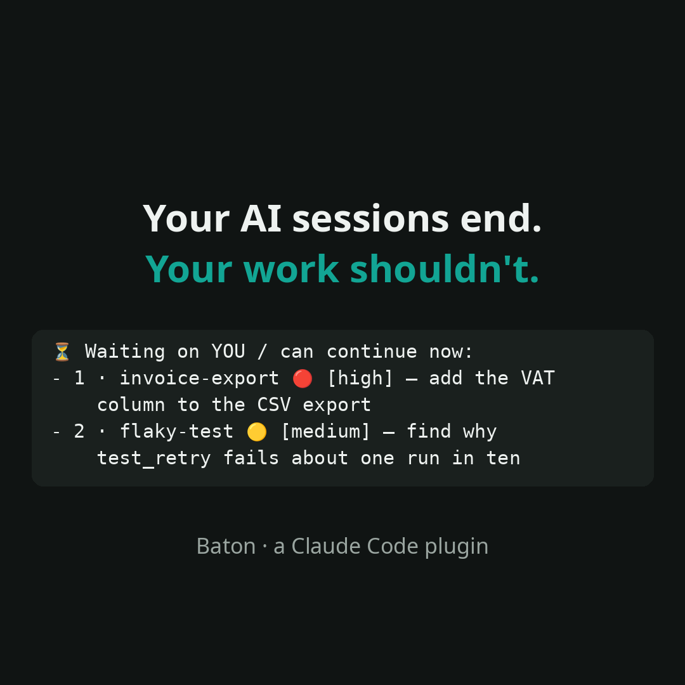
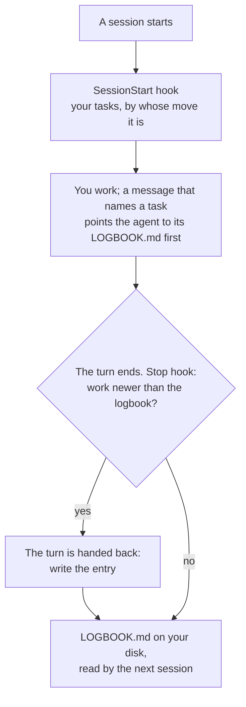

# Baton: a task logbook for Claude Code in offices and companies, enforced by hooks

**Your AI sessions end. Your work shouldn't.**

Baton is a task logbook for Claude Code, kept by hooks, for work in offices and companies as
much as for one person ([why it fits](#for-offices-and-companies)). Every task gets a folder with a
`LOGBOOK.md`. When work is newer than the logbook, a Stop hook hands the turn back and asks the
agent to write down what it did; right after compaction the agent is told to write the entry
first, from the summary and the messages after it. The next session, or the same one after
`/clear`, opens on the board of your tasks and reads the logbook first. That is the session
handoff, in plain Markdown on your disk; installed as a plugin, the hooks make no network request at all.

**It runs in Claude Code** -- the terminal, the IDE extensions, the Code tab of the desktop app.
**In a claude.ai chat the hooks do not run**: the plugin looks installed, but nothing is enforced.
The same hooks can be set up by hand under Codex CLI and Gemini CLI ([where it works](#where-it-works)).


<a href="https://github.com/StanimirTenev/baton/blob/main/docs/media/baton-demo.mp4"></a>

*34 s video (the GIF above is a 28 s cut of it): the board, a turn handed back, the entry written, the turn let through. Real hook
output, run by hand in a sandbox with made-up tasks -- no live session, and the entry was written
by hand, not by an agent. It shows the path where the entry gets written; see
[what it does not do](#measured).*

## Install

In Claude Code:

```text
/plugin marketplace add StanimirTenev/baton
/plugin install baton@baton
```

Or from a shell, as a plugin or with the install script:

```bash
claude plugin marketplace add StanimirTenev/baton && claude plugin install baton@baton
git clone https://github.com/StanimirTenev/baton ~/.baton && ~/.baton/install.sh
```

Needs Python 3.8 or later; on Windows the plugin also needs Git for Windows, and the script is
`install.cmd`. Tasks go in `~/tasks` unless you choose another. With the script, keep
the clone: the tools, the doctor too, run from it. An agent installing Baton for you reads
[docs/install.md](docs/install.md) first. Then start a new Claude Code session.

Once you have task folders, the agent's first reply opens with your tasks, ordered by whose move
it is (example data):

```text
⏳ Waiting on YOU / can continue now:
- 1 · migrate-billing 🔴 [high] — decide tax_region before the run

🔁 Ongoing:
- 2 · weekly-report 🟢 [low] — Monday export

⛔ Waiting on someone OUTSIDE / blocked (for information):
- 3 · broken-disk 🟡 [medium] — zpool replace  (waiting on: new disk (delivery))
```



## Is it working?

The new session shows one line starting `🧭 Baton` -- with no task folders yet,
`🧭 Baton is on -- no task folders yet in ~/tasks`. That line is the confirmation; once a task
folder exists, the agent's first reply opens with the board of your tasks. No line? Run
`/baton-doctor` (`/baton:baton-doctor` as a plugin): it shows when each hook last finished,
or that it crashed.

## Measured

**What it does not do**, measured on my own machine, 22–29 October 2026: the Stop hook handed
a turn back 43 times for a missing logbook entry; 29 got the entry, 14 ended without one. Baton
makes forgetting visible and hard; it does not make it impossible. Since v3.29.0 a turn that
answers the hand-back with no entry is handed back once more, and then let through.

## Where it works

| Where | Works? |
|---|---|
| Claude Code in the terminal | yes |
| Claude Code IDE extensions | yes |
| Code tab of the Claude desktop app | yes |
| claude.ai chat (web, desktop, mobile) | **no** -- hooks are ignored, only the skills load, nothing is enforced |
| Cowork | loads hooks, but Baton is untested there |
| OpenAI Codex CLI | yes, since v3.34.0 -- four of the six hooks, set up by hand: [codex/README.md](codex/README.md) |
| Google Gemini CLI | extension; live headless session proven 17.11 (v3.38.0), interactive not yet: [gemini/README.md](gemini/README.md) |

**A host, not a model.** Baton works in a *host*: an agent runtime that runs hooks when a session
starts and when a turn ends -- Claude Code, Codex CLI, Gemini CLI. The hooks read what the host
sends, not which model answers: on 17.11 the same hooks ran in Claude Code with Claude Opus 5.5,
in Codex CLI with a ChatGPT login, and in Gemini CLI with Gemini 3 Flash preview and 3.1 Pro
preview, and under each host the board reached the model; each model then read the logbook
itself. Whether a model follows the board and the hand-back is the model's; that it receives
them is the host's. **A chat in a browser runs no hooks**, so Baton enforces nothing there --
claude.ai, ChatGPT or Gemini on the web get no board, no hand-back and no logbook check.

**In a claude.ai chat nothing warns you:** the plugin looks installed and the skills load,
but no hook runs ([platform support](https://claude.com/docs/plugins/platform-support)).
A plugin added from the directory on claude.ai reaches Claude Code at its next session start.

## For offices and companies

- **Local.** Installed as a plugin, the hooks make no network request: the logbooks stay on your
  company's machines. Only tools you run by hand send anything (the review tools to OpenRouter,
  a ledger push to your own remote): [what Baton sends over the network](#what-baton-sends-over-the-network).
- **Readable without Baton.** Each task's logbook is plain Markdown in its folder: a colleague or
  a manager reads it in any editor, and a task folder handed to someone else carries its record.
- **A ledger.** A git record of every logbook entry; an edited or removed entry is reported at the
  next session start. On one machine it shows a careless edit, not a deliberate one; a copy
  pushed to a remote that refuses a rewritten history is an audit trail
  ([the ledger](#the-ledger-an-older-entry-edited-is-seen)).
- **MIT.** Free for commercial use.

Each machine keeps its own task folders and its own board; Baton does not sync them
([what it does not solve](docs/why.md)).

## FAQ

**How is this different from rules in `CLAUDE.md`?** A rule in `CLAUDE.md` is advice the agent
may skip; a hook is not. Claude Code runs Baton's hooks when a session starts and when a turn
ends, whatever the agent decides. Baton installs its rules too; the hooks are what hold them.

**How is this different from a memory plugin?** A memory store keeps what is true and brings it
back when it seems relevant. A logbook keeps what was done, task by task: dated entries, newest
on top, and the next step in the header. Baton does not choose what to remember or summarise it
for you; the agent writes each entry, you can read and edit every one, and the Stop hook checks
that it was written. The two fit together: [memory layout](docs/memory-layout.md).

**How is this different from a planning-files plugin?** Plan files keep the agent on course
within the work in progress. A task folder outlives it: weeks later, in another session, the
logbook says what was done, what was decided and whose move it is. A plan can live in the task
folder; Baton checks that the record is newer than the work.

## Documentation

- [Install in detail](docs/install.md) -- before installing, plugin or script, Windows and USB, updates, configuration
- [Skills](docs/skills.md) -- `/baton-inventory`, `/baton-task`, `/baton-plan`, and when a swarm is worth it
- [How it works](docs/how-it-works.md) -- the board, the task header, the hooks, `/baton-doctor`, lessons, the logbook entry, `.batonignore`, the ledger
- [Review tools](docs/review-tools.md) -- the optional review of an index against its files, duplicated state, reading order, the corpus
- [Memory layout](docs/memory-layout.md) -- where an agent keeps what is true, beside the logbook of what was done
- [Why this exists, and what it does not solve](docs/why.md)
- [Codex CLI](codex/README.md) -- the same hooks under OpenAI Codex: setup, trust, what does not run there
- [Gemini CLI](gemini/README.md) -- the same hooks as a Gemini CLI extension: setup, the doctor, what does not run there
- [Languages](hooks/lang/README.md) -- the words the hooks recognise, one file per language

Below: [The page and friends](#the-page-and-friends), [The ledger](#the-ledger-an-older-entry-edited-is-seen), [Uninstall](#uninstall), [What Baton reads, writes and injects](#what-baton-reads-writes-and-injects), [What Baton sends over the network](#what-baton-sends-over-the-network), [Versions](CHANGELOG.md).

## The page and friends

On the first session start of each version (after an install or an update) Baton opens a page of
its own in your browser: this install's ID with a copy button, what is new in this version, an
**Update Baton** button, and your friends. Where no browser can appear (over SSH, Linux without a
display, an SDK or CI run, or `BATON_NO_BROWSER=1`) nothing opens; the line at the top of the
session carries the link instead, `🆕 page: http://127.0.0.1:<port>/<key>/`, until a session can
open it. The link is on that line only: the agent never gets it, because the page's buttons are yours.

The page is served by `tools/baton_page.py`, which ships with Baton (Python's own library only). It
listens on 127.0.0.1 only, on a port the system picks, and answers only a request that carries the
random 128-bit key from its link, a `Host` of `127.0.0.1:<port>` and no other site's `Origin`.
**That key stops other web pages in your browser from pressing the buttons; it does not stop a
program running on this machine as you**, which can read the key from the state file. One server per
install, reused by every session; it stops by itself after 30 minutes without a request.

**Update Baton.** As a plugin, a click runs Claude Code's own two commands, `claude plugin
marketplace update <catalog>` and `claude plugin update baton@<catalog>`, shows their output and asks
you to restart the session. Nothing runs without the click. Installed by script, or as a Gemini or
Codex clone, the page shows how that install is updated and runs nothing.

**Friends.** There is no server and no directory: an invitation is a code you send yourself.

1. **Invite a friend** makes a code with your ID, your public key, an optional text of up to 140
   characters, the time and a random number, signed with this install's key
   (`ssh-keygen -Y sign -n baton-invite`). Send it by any channel: a message, a mail, in person.
2. Your friend pastes it into their page. Their Baton checks the signature against the key in the
   code and that the key gives the ID it claims, then shows your ID and text, as plain text, links not
   clickable. **Accept** or **Ignore**; ignoring tells nobody.
3. Accepting makes a reply code for you, signed the same way and naming your invitation. Their page
   shows you as "send them your reply" and keeps the code to copy again; nothing comes back to it.
4. You paste the reply. It must answer an invitation made on your install and still waiting; each is
   used once. Now you are friends on your side too.

**Remove** stops new things only: what a friend already has stays with them. The agent hears how many
invitations wait (`👥 1 invitation waiting`), never their text. Without a browser:

```
python3 tools/baton_page.py --invite "Hi, it's Ana"   # prints an invitation code
python3 tools/baton_page.py --accept CODE             # accept an invitation (prints the reply), or take in a reply
python3 tools/baton_page.py --open                    # open the page; the link is not printed
python3 tools/baton_page.py --serve --no-open         # run the page here and print its link, for a demo
```

`--accept` does not print an invitation's text; the page shows it. The server stops after 30 minutes
without use; `--open` starts it again, and while invitations wait the agent is told that command
(never the link), so "open the Baton page" is enough. What pairing does **not** protect:

- **The ID is 60 bits**, short so it can be read aloud. The code carries the whole key, and the ID is
  checked against it, but compare IDs over a channel you trust: someone who can change the code on its
  way can put in their own.
- **Your friend's agent is your friend's.** Whatever of yours reaches their machine (in later versions,
  the entries of a shared task) their agent may read and send to its own provider, under their account.
- **On disk the text is plain.** `friends.json` is readable by any program running as you, the
  agent's own tools included; Baton only never puts it in the agent's context.
- The signature says who made a code, not that its text is safe. Friends exist only on this page in
  v3.43.0: nothing else uses them yet.

## The ledger: an older entry edited is seen

A logbook entry is a record, and is not edited. Beside the logbooks Baton keeps a ledger: a git
repository of its own that only grows, one line per entry with the sha256 of its text, each line
chained to the one before. Stop records every new entry on a turn it lets through; SessionStart
says when a recorded entry changed or is gone; you decide, with `tools/baton_ledger.py verify`
and `ack`. On by default; `"ledger": false` in `baton.local.json` turns it off. **On this machine
it shows a careless edit, not a deliberate one**: the agent runs as you and can rewrite the
ledger or run `ack` itself, unless a copy is pushed to a remote that refuses a rewritten history.
All of it: [the ledger](docs/how-it-works.md#the-ledger-an-older-entry-edited-is-seen).

## Uninstall

**Plugin:** `claude plugin uninstall baton` (add `--keep-data` to keep its settings; without it the state folder and the ledger in it are deleted, a pushed copy of the ledger stays).

**Script install:** remove the six hook entries whose command runs a `baton_` script
(`baton_session_start.py`, `baton_stop.py`, `baton_prompt.py`, `baton_batch.py`,
`baton_stop_failure.py`, `baton_pretool.py`) from `~/.claude/settings.json`,
delete the Baton section from `~/.claude/CLAUDE.md` (the heading
`# Baton — task folders and logbooks` and the text under it, marked
`<!-- Installed by Baton. ... -->`), and remove `~/.claude/baton`, the five skills
`~/.claude/skills/baton-inventory`, `baton-plan`, `baton-task`, `baton-key` and `baton-doctor`, and the clone
(`~/.baton`).

Either way, your task folders are plain directories of plain Markdown -- they keep working
without any of this, which is the point.

## What Baton reads, writes and injects

Baton changes what Claude Code knows at the start of a session: that is what it is for, and
you install it for that. Everything it hands over comes from files on your disk that you can
open, edit or delete; nothing is hidden or encoded. Checked against the code of v3.43.0.

**Reads**, on this machine only: your task folders and their logbooks; `.batonignore` and
Baton's own settings; the session's transcript file that Claude Code writes, for the times,
the size of the context, and the messages you typed and the agent's text replies since the
last logbook entry; at session start, the previous session's transcript in the same project
folder (the messages you typed and their times, set beside the entries written then) and, while
you have no task folders, how many earlier transcripts there are, to offer `/baton-inventory`;
the text of tool results, for an empty or failed read (lesson L2); at session start, the
transcript of the most recent session whose last turn was cut off, for the task that turn worked in; and the text about to go into a
logbook, for a typed hour in a heading (lesson L1). These are Claude Code's own files on your disk; Baton reads them
there and asks nothing of Claude's memory or of any service.

**Writes:**

| where | what |
|---|---|
| your task root | the root itself, if it is missing, at the first session |
| `~/.claude/baton/identity/baton_ed25519` (+ `.pub`) | since v3.42.0: this install's own key, made once by `ssh-keygen` (Ed25519, no passphrase, readable only by you). Its short fingerprint, `BTN-XXXX-XXXX-XXXX`, is the ID shown above the board at every start and `/clear` -- the number you give to people you trust, for tasks shared between them (still being built). Nothing is sent anywhere. Delete the folder and a new ID is made; `BATON_IDENTITY` points it elsewhere |
| `~/.claude/baton/baton.page.json` (beside the identity folder) | since v3.43.0: the page server's pid, port, version and the random key of its link, readable only by you; written when it starts, removed when it stops. Beside it `baton.page.lock` for a moment while a server starts |
| `~/.claude/baton/identity/friends.json` | since v3.43.0: your friends (ID, public key, whether both sides accepted, the text of their invitation), the invitations you made that wait for a reply, and those pasted on the page and not yet decided; `friends.lock` beside it while it is written |
| `<task root>/.baton-ids.json` | the task numbers the board shows, so a task can be named by its number; a number is never changed or reused |
| `<task root>/.baton-chat/<session>.md` | the conversation since the last logbook entry: your messages and the agent's text replies, no tool calls or output, masked, at most 40,000 characters, readable only by you. Trimmed as logbook entries cover it, removed when nothing is left, moved to the state folder at the next session start or `/clear`. Beside it a `.gitignore` of `*` (since v3.39.0), so a task root that is a git repository never takes it |
| `<task folder>/<logbook>` | only when a turn ends on an API error (StopFailure, since v3.40.0): one entry, `turn ended on <error>`, with the files written in that turn, in the logbook of the one task folder the turn worked in. Never in a folder it cannot tie the turn to |
| `.baton-outside.md` in a task folder (or the task root) | one line when a command sent something off this machine (a push, a pull request or issue, a release, an upload to PyPI or npm), to be put in that task's next entry |
| `baton.ledger/` in Baton's state folder, or where `ledger` in `baton.local.json` says | [the ledger](#the-ledger-an-older-entry-edited-is-seen): a git repository with one line per logbook entry (task root as `~/...`, folder, heading, time, two hashes, the host whose Stop recorded it; an ack's reason), committed by Stop on a turn it lets through; off with `"ledger": false`; beside it `baton.ledger.seen.json` and a lock while it is written. Never pushed by Baton |
| Baton's state folder (`${CLAUDE_PLUGIN_DATA}` as a plugin, beside the hooks for a script install) | when each hook last ran, per-session notes, the lesson counts, the output of a test command you pinned, and the moved conversation files, deleted at a later session start once 7 days old |
| `~/.claude/settings.json`, `~/.claude/CLAUDE.md` | **script install only**: the six hook entries and the Baton section, each with a copy of the file as it was. As a plugin neither file is touched |

The hooks never write a logbook; the agent does, and you can read every entry. While
`tools/baton_entry.py` writes one it holds `.<logbook>.lock` beside it and writes through a
`.<logbook>.<pid>.tmp`; both are gone when it returns, unless it is killed while writing
(a lock left so is taken over after 60 s).

**Injects** into the agent's context, as hook output:

- at session start: the board (your task names and the header lines of their logbooks), the
  last 2,500 characters of the kept conversation with the path to the rest, notices about
  Baton itself, and, when the ledger differs from the logbooks, the folders and headings of the
  entries that did; as a plugin also Baton's rules, the text of `templates/CLAUDE.md` shipped with it (with the task root, the logbook name and the path of `tools/baton_entry.py` filled in);
- at session start, when invitations pasted on the page wait for your decision: how many, never
  their text and never the page's link;
- when a message names a task: which task, the date of its last entry, its next step, and that
  the logbook is to be read first;
- before a write: a note when a new or changed logbook heading carries a typed hour, with the
  path of `tools/baton_entry.py`. It never allows or blocks a tool call;
- after a batch of tool calls: a note when a read came back empty or failed, and the line
  written to `.baton-outside.md`;
- at the end of a turn: the turn is handed back when work is newer than the logbook, or when much
  was said since the last entry.

**Not done:** no profile of you is built, the hooks send nothing of the conversation anywhere,
and no instruction is fetched from anywhere. As a plugin the hooks make no network request; the
review tools you run by hand send the text under review, as the table below says. Installed
by script, the opt-in weekly update check fetches the latest release number and its page
address, and only those two go into a fixed sentence; see the table below. Besides a test command
you pinned yourself, the commands the hooks run that are not their own are `ssh-keygen`, once,
to make this install's key (below), and, on the first session start of a version, the browser
opener of the system (`xdg-open`, `open`, or Windows' own) to open [the page](#the-page-and-friends).
The page's server is Baton's own `tools/baton_page.py`; it runs `ssh-keygen -Y sign` and `-Y verify`
for invitations, and `claude plugin marketplace update` and `claude plugin update` only when you
click **Update Baton**.

**To remove what was kept:** delete `<task root>/.baton-chat/` and the `baton-chat-*.md` files in
Baton's state folder. Keeping the conversation has no switch to turn it off in v3.43.0.

## What Baton sends over the network

| what | when | to |
|---|---|---|
| the hooks, installed as a plugin | never (once a week they only remind you to check for a newer version yourself) | -- |
| the hooks, installed by script | once a week (a failed check is retried the next day), **only if you switched the update check on** (`tools/baton_update.py on`); off until you choose | `api.github.com/repos/StanimirTenev/baton/releases/latest` -- a version number back, nothing of yours sent |
| the page's server, `tools/baton_page.py` | listens while it runs (from the first session start of a version until 30 minutes without use); it sends nothing | nowhere: it listens on 127.0.0.1 only, and answers only requests that carry the random key from its link. The key stops other web pages; it does not stop programs on this machine running as you |
| **Update Baton** on the page, as a plugin | only when you click it | Claude Code's own `claude plugin` commands fetch the catalog and the new version, as they do when you type them |
| `tools/baton_key.py` | when you run it, to check the key you give it | `openrouter.ai` |
| `tools/baton_ledger.py push`, `verify --remote` | when you run them, and only after you added a remote to the ledger's repository | that remote, by git -- the ledger: the task root (`~/...` under home), folder names, entry headings, times, hashes, ack reasons, and commit messages naming folders |
| `tools/baton_review.py`, `tools/baton_sift.py` | when you run them | `openrouter.ai` -- the text under review; anything holding a word listed in `review_confidential` (in its path or its text) is held back before anything is sent |

`tools/baton_corpus.py` and every other tool work on your files only. Nothing runs on a
schedule except the opt-in update check above. Besides `ssh-keygen`, run once on this machine to
make the install's key (no network), and the system's browser opener for the page, the one command
the hooks run that is not their own is a test command **you** pinned in `baton.local.json` (lesson L4, since v3.21.0): run on this
machine after a turn whose entry says tests pass, and never without that pin.

What the hooks read, write and hand to the agent, all on this machine, is in
[What Baton reads, writes and injects](#what-baton-reads-writes-and-injects). The review tools send only with the
key given to Baton by `tools/baton_key.py` — never a key found in the environment or in
another tool's files.

### For the plugin directory's reviewer

The scan holds Baton on three warnings. What each flagged file does, checked against v3.29.0:

- **A key read from the user's machine** (`hooks/baton_session_start.py`,
  `.claude-plugin/plugin.json`). The only key Baton reads is the user's OpenRouter key, and only
  three tools the human runs by hand read it: `tools/baton_review.py` (from
  `~/.config/baton/env`, where `tools/baton_key.py` stored it after the human typed it in),
  `tools/baton_sift.py` (through `baton_review`) and `tools/baton_key.py`. They send it only to
  OpenRouter, the key's own vendor, in the header of their requests. No hook reads it.
  Since v3.29.0 `baton_session_start.py` no longer touches the environment or the key file
  at all: what did -- the board's fixed list of environment names (`BOARD_ENV`: path, home,
  temp, locale, where Baton keeps its settings, and what a browser needs to appear), the check
  whether the key file exists (to offer the review once; it is never opened) and the masking
  of a key pasted into a message -- is in `hooks/_baton.py`, which makes no network request.
  The session hook's one network request is the opt-in update check (`update_notice`): a GET
  for the latest release number on GitHub that sends nothing of the user's, never made as a
  plugin. Since v3.43.0 it also starts `tools/baton_page.py`, which listens on 127.0.0.1 and
  sends nothing; its environment is built in `hooks/_baton.py` from a fixed list (`PAGE_ENV`). `plugin.json` reads nothing: its description only says that the review tools send
  text to OpenRouter, and it was flagged the same way from v3.15.0, when it did not mention
  OpenRouter at all. A `userConfig` option would not reach these tools -- Claude Code hands
  plugin options to hook processes, and these tools are run by hand.
- **An image file the plugin's code could run** (`install.sh`, `.claude-plugin/plugin.json`).
  `icon.png` is the listing icon named in `plugin.json`. Nothing runs or copies it:
  `install.sh` does not name it and copies only the named hooks and each `skills/*/SKILL.md`.
- **A download-and-run command.** In `hooks/baton_batch.py` it is a regular expression that
  tells reading commands (`curl`, `wget`, ...) apart; in `hooks/baton_session_start.py` the text
  of a message that tells the human how to update a script install (`git pull` and the
  installer), which the hook never runs; in `README.md` and `docs/install.md`, documentation.
  `setup-windows.cmd` is a setup helper the human starts by hand, outside the plugin: it
  downloads Claude Code's own installer from `claude.ai/install.cmd` and runs it.


## Versions

What changed in each version is in [CHANGELOG.md](CHANGELOG.md), and in the [releases](https://github.com/StanimirTenev/baton/releases).
